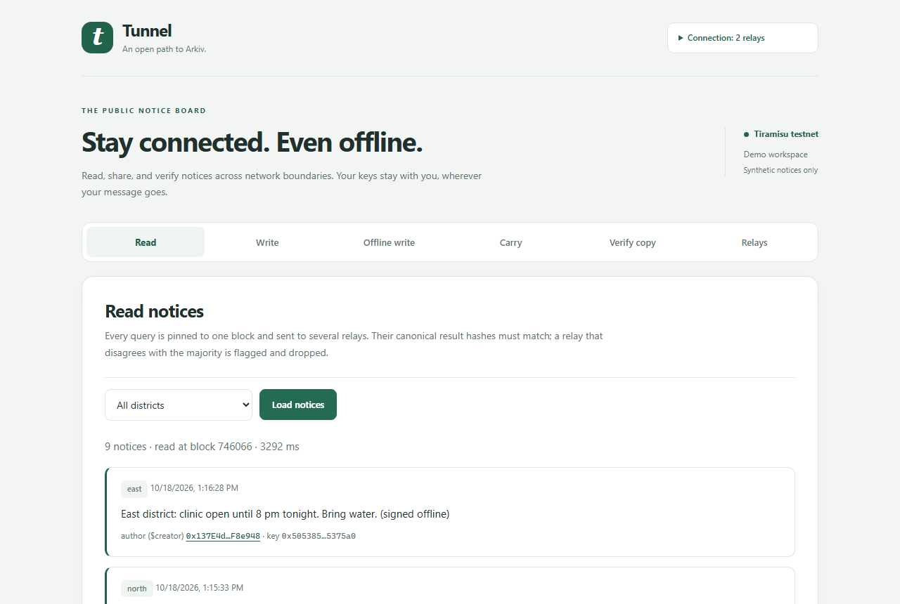
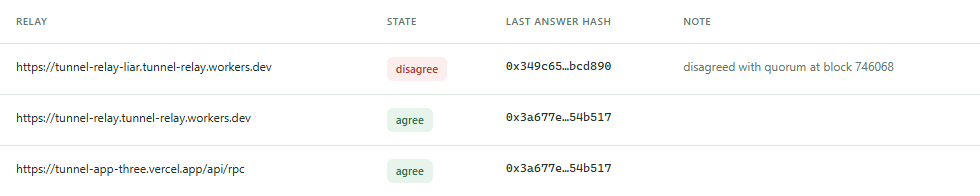
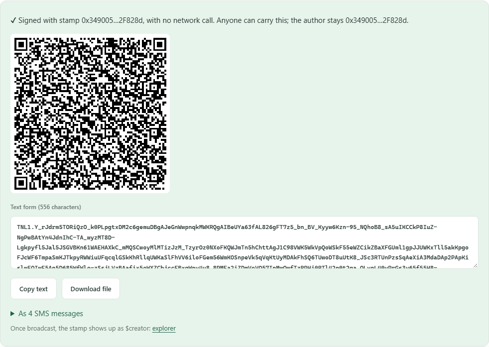
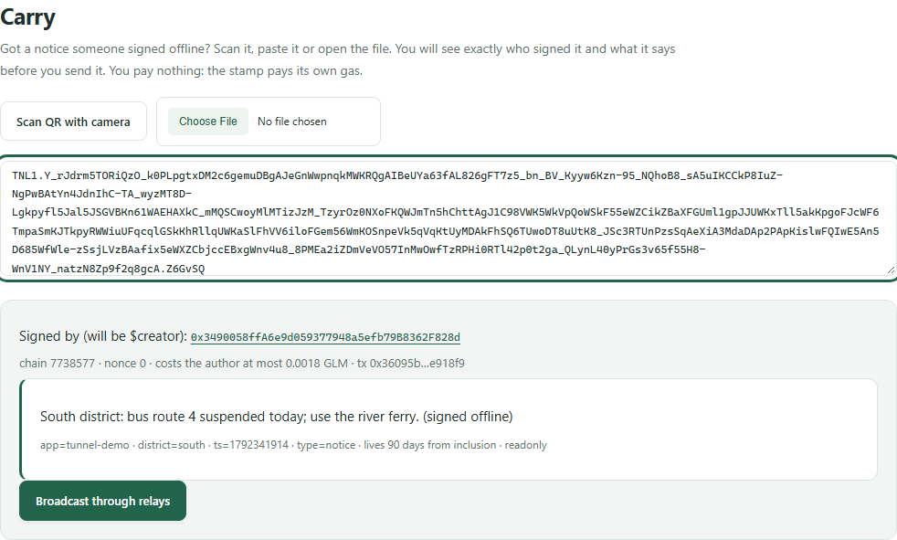
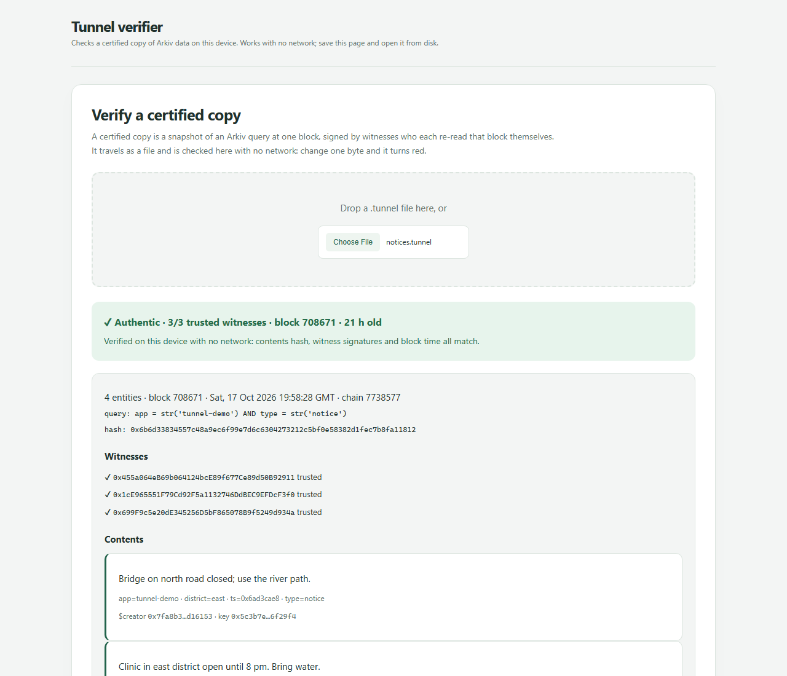
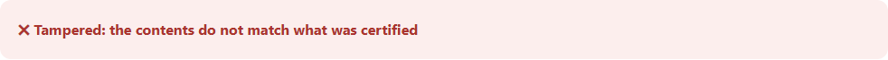
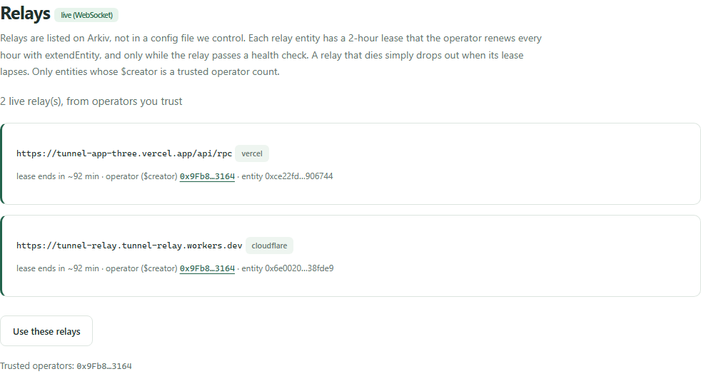

<div align="center">


# Tunnel

**Arkiv access that works through firewalls and offline.**
A one-line change for developers. Nothing to install for users.

[](https://github.com/CapThunder19/Tunnel/actions/workflows/ci.yml)
[](LICENSE)
[](packages/tunnel/src)
[](https://docs.arkiv.network)
[](https://tiramisu.explorer.arkiv.network)
[](https://tunnel-app-three.vercel.app)

[**Live app**](https://tunnel-app-three.vercel.app) ·
[**Offline verifier**](https://tunnel-app-three.vercel.app/verify.html) ·
[Schema](arkiv/schema.md) ·
[Friction report](arkiv/friction.md) ·
[Demo script](docs/demo.md)

<br />



</div>

---

> Built for **Arkiv: Global Tour Stop (pre-Devcon 8)** · Tracks: **Censorship Resistance**, **Open Source**, **Security**

## Table of contents

- [Why Tunnel](#why-tunnel)
- [Features](#features)
- [Quick start (developers)](#quick-start-developers)
- [Try the live demo](#try-the-live-demo)
- [How it works](#how-it-works)
- [Why Arkiv](#why-arkiv)
- [Run it locally](#run-it-locally)
- [Run your own relay](#run-your-own-relay)
- [API reference](#api-reference)
- [On-chain evidence](#on-chain-evidence)
- [Honest limits](#honest-limits)
- [Project structure](#project-structure)
- [Contributing](#contributing) · [Security](#security) · [License](#license)

## Why Tunnel

Every censorship-resistant Arkiv app says "you can read the data from Arkiv without our backend".
That is not true for two groups of people:

1. **People whose network blocks the Arkiv RPC.** State firewalls, school and office networks and
   mobile carriers block by domain. Block `rpc.tiramisu.db-chain.testnet.arkiv.network` and every
   Arkiv app goes dark for them, however decentralised the data is.
2. **People who are offline.** During an internet shutdown, in a disaster zone, or with SMS-only
   phones, nobody can write to Arkiv or check that a copy of Arkiv data is genuine.

Tunnel makes Arkiv reachable in every network condition, and it never asks the user to trust the
intermediaries it uses.

| Condition | Write | Read |
|---|---|---|
| **Internet works, Arkiv RPC blocked** | Through **relays** on platforms that are costly to block (Cloudflare Workers, Vercel). The tx is signed on the device; a relay can only forward it, **never alter it**. It goes to every relay at once, so one honest, reachable relay is enough. | The same query goes to several relays **at the same pinned block** (`atBlock`), and their canonical result hashes are compared. A relay that disagrees with the majority is flagged and dropped. |
| **Offline / SMS only** | Sign on the device with a pre-funded **stamp** and export it as a **QR code, a file or ~4 SMS**. Anyone (a *carrier*) broadcasts it later. `$creator` stays the author, never the carrier. | A **certified copy**: a snapshot file plus witness signatures, checked fully offline by a single HTML file. Change one byte and it turns red. |

<details>
<summary><b>Why not just use a VPN?</b></summary>

- A VPN needs every user to install something, and VPN apps and protocols are themselves blocked
  or criminalised in several countries.
- A VPN does nothing offline.
- Tunnel is a **one-line change for the developer**: swap the transport, and every user of that app
  gets it automatically, in a normal browser tab. Its offline paths work with no connection at all.

</details>

## Features

<table>
<tr>
<td width="50%" valign="top">

### Quorum reads that catch lying relays
Every `arkiv_query` is pinned to one block and asked of several relays. Their answers are
canonicalised and hashed, the strict majority wins, and the minority is flagged for the rest of the
session. With no majority, Tunnel shows nothing rather than guess.

</td>
<td width="50%" valign="top">



</td>
</tr>
<tr>
<td width="50%" valign="top">



</td>
<td width="50%" valign="top">

### Offline writes with stamps
While online, fund a few one-shot stamps. Later, in airplane mode, sign a notice with the real
Arkiv SDK and **no network call**. It comes out as a QR code, a `.tnl.txt` file or 4 SMS
(530 chars, deflated, checksummed). Lifetimes are relative to inclusion, so a notice carried three
days later still gets its full 90 days.

</td>
</tr>
<tr>
<td width="50%" valign="top">

### Carriers can't change or claim it
A carrier scans the QR code or pastes the text and sees **who signed it and what it writes**
before broadcasting. The stamp pays its own gas, and on chain `$creator` is the stamp: carrying
gives no authorship.

</td>
<td width="50%" valign="top">



</td>
</tr>
<tr>
<td width="50%" valign="top">




</td>
<td width="50%" valign="top">

### Certified copies, verified with no network
A snapshot of a query at one block, re-read and signed by independent witnesses. Each one also
writes a readonly, community-extendable `attestation` entity on Arkiv. The verifier is a
**single 64 KB HTML file** that works from disk: contents, signatures and block time are all
checked. Try it with [examples/notices.tunnel](examples/notices.tunnel).

</td>
</tr>
<tr>
<td width="50%" valign="top">

### A relay registry that keeps itself honest
Relays list themselves on Arkiv as **2-hour leases**. An hourly Cloudflare cron renews each lease
with `extendEntity`, **only while the relay is healthy**, so dead relays drop out on their own.
Clients trust entries by `$creator`, and the page updates live over a **WebSocket**
`watchEntityEvents` subscription.

</td>
<td width="50%" valign="top">



</td>
</tr>
</table>

## Quick start (developers)

Swap one transport. Your existing Arkiv SDK code doesn't change.

```ts
import { createPublicClient, createWalletClient } from '@arkiv-network/sdk'
import { tiramisu } from '@arkiv-network/sdk/chains'
import { eq } from '@arkiv-network/sdk/query'
import { tunnel } from 'arkiv-tunnel' // packages/tunnel

const relays = [
  'https://tunnel-relay.tunnel-relay.workers.dev', // Cloudflare Workers
  'https://tunnel-app-three.vercel.app/api/rpc', // Vercel Edge
]

// before: transport: http()
const client = createPublicClient({ chain: tiramisu, transport: tunnel(relays) })
const wallet = createWalletClient({ chain: tiramisu, account, transport: tunnel(relays) })

await client.select('*').where(eq('type', 'notice')).fetch() // quorum read at a pinned block
await wallet.createEntity({ ... }) // signed locally, broadcast to every relay
```

Catching a disagreement:

```ts
import { findTunnelError, RelayDisagreement } from 'arkiv-tunnel'

try {
  await client.select('*').where(eq('type', 'notice')).fetch()
} catch (err) {
  const d = findTunnelError(err, RelayDisagreement)
  if (d) console.warn(`relays disagree at block ${d.block}`, d.answers)
}
```

## Try the live demo

Nothing to install. Open **https://tunnel-app-three.vercel.app**.

| # | Do this | You'll see |
|---|---|---|
| 1 | **Read** → *Load notices* | Two relays (Cloudflare + Vercel) agree on one hash at one block |
| 2 | *Connection* → tick *Add a deliberately lying relay* → *Load notices* | The liar is flagged **disagree**; the honest data is still shown |
| 3 | Download the [sample copy](https://tunnel-app-three.vercel.app/examples/notices.tunnel) and drop it on **Verify copy** or on the [standalone verifier](https://tunnel-app-three.vercel.app/verify.html), with Wi-Fi off | **Authentic · 3/3 trusted witnesses**. Edit one character of a `payload` and drop it again: **Tampered** |
| 4 | **Write**: send the shown device address ~0.01 test GLM from the [faucet](https://hub.arkiv.network/faucet), then post | Entity key, tx link, `$creator` = your device |
| 5 | **Offline write**: fund a stamp, **turn Wi-Fi off**, sign; turn Wi-Fi on, paste into **Carry**, broadcast | QR / text / SMS parts; on chain `$creator` is the stamp |
| 6 | **Relays** | Live leases from Arkiv, renewed hourly, updating over WebSocket |

## How it works

```
                         ┌───────────────────────── user's device ─────────────────────────┐
                         │  app / any Arkiv dApp                                           │
                         │    └─ Arkiv SDK ── tunnel() transport                           │
                         │         keys + signing stay here                                │
                         └──────────┬───────────────────┬──────────────────┬───────────────┘
              same raw tx / same    │                   │                  │
              query @ block N       ▼                   ▼                  ▼
                         Cloudflare Worker      Vercel Edge fn       (any relay you run)
                          relay (stateless,     relay (same core)     e.g. relay/src/node.ts
                          allowlist, no logs)
                                    └───────────────────┼──────────────────┘
                                                        ▼
                                          Arkiv node (Tiramisu) ◄── Arkiv Hub key lives in relays only

  answers compared: canonical sha256 of entities @ block N ── majority wins, minority flagged "bad"

  OFFLINE                                    CERTIFIED COPY
  stamp key ─ signOffline() ─ QR/file/SMS    takeSnapshot(@N) ─► witnesses each re-read @N,
       └─ carrier ─ broadcast() ─ relays          sign, write `attestation` entity on Arkiv
          ($creator = stamp, not carrier)    .tunnel file ─► verify.html (no network) ─► ✔ / ✖

  RELAY REGISTRY
  `relay` entity (2 h lease) ◄─ hourly cron: healthy? extendEntity : let it lapse
  clients: listRelays(trusted operators by $creator) + watchEntityEvents over WebSocket
```

## Why Arkiv

Tunnel depends on three Arkiv properties. Without them it falls apart.

| Arkiv property | What Tunnel builds on it | What breaks without it |
|---|---|---|
| **`$creator`** is set by the chain from the tx signature and never changes | An offline-signed notice keeps its author whoever carries it, and verifiers trust attestations and relay leases by `$creator`. A relay or carrier has no way to put its name on someone else's data. | **Postgres / our own API:** authorship is a column the operator writes, so it can be forged or reassigned. Offline submissions would need the server to vouch for them. |
| **Queryable state at an exact block** (`arkiv_query` + `atBlock`) | Quorum reads: independent relays answer *the same question about the same state*, so honest answers are byte-identical and a liar stands out. Certified copies name a block anyone can re-query to reproduce the hash. | **Our own API / a subgraph:** there is no shared pinned view, so two honest servers differ by height and you can't tell a liar from a laggard. A subgraph is one operator's indexer. **IPFS** proves a file is unchanged, but can't answer queries or say who published what, or when. |
| **Entity Expiration, Lifetime Extension, creation flags** | Relay list = 2 h leases renewed with `extendEntity` only while healthy, with no server. Notices are `readonly`, 90 days from inclusion. Attestations are `readonly` + `permissionlessExtension`, 30 days, and anyone relying on a copy can keep them alive. | **Postgres / our API:** the relay list is a server someone must run (and can censor), and "readonly" and "anyone may extend" are policies an operator can switch off. **IPFS:** unpinned data vanishes silently. |

**Deliberately kept off Arkiv:** every private key (device, stamps, witnesses, operator), the
certified-copy files themselves (they must travel offline), signed txs waiting to be carried, relay
logs and IPs (relays keep none), the Hub access key (relay secrets only), and any real personal data
(all notices are synthetic). Details: [arkiv/schema.md](arkiv/schema.md).

## Run it locally

Requires **Node 20+**.

```sh
git clone https://github.com/CapThunder19/Tunnel && cd Tunnel
npm install
cp .env.example .env.local          # PRIVATE_KEY = funded Tiramisu key; ARKIV_API_KEY optional
npm test                            # 36 unit tests (library + relay), no network needed
npm run typecheck

# three local relays (one lies) + the app on http://localhost:5173
npx tsx relay/src/node.ts --port 8787 --name local-a
npx tsx relay/src/node.ts --port 8788 --name local-b
npx tsx relay/src/node.ts --port 8789 --name liar --lie     # DEMO ONLY
npm run dev -w tunnel-app

npm run build -w tunnel-app         # app/dist + single-file app/dist/verify.html
```

End-to-end scripts against the live testnet:

```sh
npx tsx scripts/smoke-read.ts <relayA> <relayB> [<liar>]   # quorum read; a liar gets flagged
npx tsx scripts/smoke-write.ts                 # write through relays, read back, $creator = you
npx tsx scripts/offline.ts fund 1              # online: fund a stamp (key stays in stamps.local.json)
npx tsx scripts/offline.ts sign "your text"    # works with networking disabled
npx tsx scripts/offline.ts carry               # any machine: shows the author, broadcasts
npx tsx scripts/certify.ts                     # snapshot; 3 witnesses re-read, sign, attest
npx tsx scripts/verify.ts examples/notices.tunnel   # offline check
npx tsx scripts/registry.ts renew              # one lease round (what the cron does hourly)
npx tsx scripts/watch-relays.ts 60             # renewals arriving over a WebSocket subscription
```

## Run your own relay

A relay is a ~100-line stateless JSON-RPC forwarder ([relay/src/core.ts](relay/src/core.ts)). It:
- forwards only `eth_*` (minus signing/account methods), `arkiv_*`, `net_version` and `web3_clientVersion`
- sends CORS headers, serves `GET /health`, and passes `429` + `Retry-After` through
- **logs no IPs and no bodies**
- holds the Arkiv Hub key (`ARKIV_API_KEY`, sent upstream as `X-API-KEY`), so browsers never see it

It can't forge writes, and it can't forge reads without being caught. **More independent relays
make every Tunnel user harder to censor.**

<details open>
<summary><b>Cloudflare Workers</b></summary>

```sh
cd relay
npx wrangler login
npx wrangler secret put ARKIV_API_KEY     # optional, from https://hub.arkiv.network/api-keys
npx wrangler secret put OPERATOR_KEY      # optional: funded key that renews relay leases (hourly cron)
npx wrangler deploy                       # → https://tunnel-relay.<you>.workers.dev
```

</details>

<details>
<summary><b>Vercel (app + relay)</b></summary>

Import the repo with the root directory set to the repo root (`vercel.json` sets the build), and
add `ARKIV_API_KEY` (optional). The app is served from `app/dist`, and the relay at `/api/rpc`.

</details>

<details>
<summary><b>Any machine (Node)</b></summary>

```sh
npx tsx relay/src/node.ts --host 0.0.0.0 --port 8787
```

</details>

**Deployed relays**

| Relay | Platform | Health |
|---|---|---|
| `https://tunnel-relay.tunnel-relay.workers.dev` | Cloudflare Workers (+ hourly lease cron) | [/health](https://tunnel-relay.tunnel-relay.workers.dev/health) |
| `https://tunnel-app-three.vercel.app/api/rpc` | Vercel Edge Function ([api/rpc.ts](api/rpc.ts)) | [GET /api/rpc](https://tunnel-app-three.vercel.app/api/rpc) |
| `https://tunnel-relay-liar.tunnel-relay.workers.dev` | Cloudflare Workers, **deliberately lying (`LIE=1`), demo only** | [/health](https://tunnel-relay-liar.tunnel-relay.workers.dev/health) |

## API reference

| Function | What it does |
|---|---|
| `tunnel(relays, { quorum = 2 })` | viem transport. **`arkiv_query`:** pins a block, asks `quorum` relays, compares sha256 of canonical results; on a mismatch it asks the rest and goes with the strict majority, or throws `RelayDisagreement`. **`eth_sendRawTransaction`:** all relays in parallel; a relay that returns a wrong tx hash is flagged. Rotates on network errors and 429 (`Retry-After`). Never pins below a block it saw a receipt for (read-your-writes). `eth_chainId` is answered locally. |
| `findTunnelError(err, Class)` | Digs a `RelayDisagreement` / `NoHealthyRelayError` out of viem's error wrapping |
| `createStamps(n, wallet)` | Generates and funds one-shot stamp keys while online |
| `signOffline(stampKey, createParams)` | The real SDK `createEntity` through a transport that never touches the network |
| `encode` / `decode` / `splitSms` / `joinSms` | `TNL1.<deflated base64url tx>.<checksum>`: ~530 chars per notice, damage detected |
| `inspect(rawTx)` / `broadcast(text, client)` | For carriers: recover the author, decode what it writes, send it |
| `takeSnapshot(client, query)` | Every page of a query at one block, plus block time and canonical hash |
| `attest(snapshot, wallet, reader)` | Re-read independently, refuse on mismatch, sign (EIP-191), write an `attestation` entity |
| `verifyOffline(bundle, trusted)` | Pure: recompute the hash, check signatures, count trusted witnesses |
| `listRelays(client, operators)` / `renewLeases(operator, relays)` | Relay registry: 2 h leases, `extendEntity` while healthy, trusted by `$creator` |

Data contracts: [canonical hashing](packages/tunnel/src/canonical.ts) · [`TNL1` text format](packages/tunnel/src/offline.ts) ·
[certified-copy bundle `tunnel-certified-copy/v1`](packages/tunnel/src/verify.ts) · [entities and queries](arkiv/schema.md)

## On-chain evidence

Tiramisu testnet, chain `7738577`.

| Address | Role |
|---|---|
| `0x455a064eB69b064124bcE89f677Ce89d50B92911` | Main wallet: posts notices through relays, funds stamps, witness #1 |
| `0xC540e63E94fA1aB03B8d1A8dDd1FC2847a83D996` | Stamp #1: `$creator` of a notice signed offline |
| `0x7FA8B37b86170f6164EB2f6E4E80dfBf43D16153` | Stamp #2: `$creator` of a notice signed offline |
| `0x1cE965551F79Cd92F5a1132746DdBEC9EFDcF3f0` | Witness #2: `attestation` entities |
| `0x699F9c5e20dE345256D5bF865078B9f5249d934a` | Witness #3: `attestation` entities |
| `0x9Fb8276AA99d5778C7562E4A46A73536F3803164` | Relay operator: `relay` leases, renewed hourly by the Cloudflare cron (30+ txs so far) |
| `0xEabdA3CBbd7dCA7B0e30FA1c6A6237cF9f7Ef59d` | Browser device key used for the demo video and screenshots |

Browser keys generated in the live app (by you or by judges) also create `notice` entities.

<details>
<summary><b>Key transactions</b></summary>

| What | Transaction |
|---|---|
| Notice written through two relays | [`0x2c2d9d1f…`](https://tiramisu.explorer.arkiv.network/tx/0x2c2d9d1fcb7dd0e064089b9f5fdc7a5907215121dfaaf93f0c8943c0bacff35f) |
| Stamp funding | [`0xbc312384…`](https://tiramisu.explorer.arkiv.network/tx/0xbc31238434a220e780e152596276ac1c199ece3b8cbb6a82d87c6cea4e8bcd0f) |
| Notice signed offline by stamp #1, broadcast by a carrier | [`0xa92bfa72…`](https://tiramisu.explorer.arkiv.network/tx/0xa92bfa727ed132b7a019ea0592050af61cd8d932d7c2987b6d3d94bf3ee25078) |
| Notice signed offline by stamp #2, carried as 4-SMS text | [`0xdd789c71…`](https://tiramisu.explorer.arkiv.network/tx/0xdd789c71f7c08aac4459b6c54c10e7c91136ee724d9aa33a5f44519e1e04bc2c) |
| Attestation of [examples/notices.tunnel](examples/notices.tunnel) (block 708671) by the main wallet | [`0xea60869d…`](https://tiramisu.explorer.arkiv.network/tx/0xea60869d2b24b35f361e7db01d3b8c3611f8f575426a4840a6ba41628fd02b5f) |
| … by witness #2 | [`0x29c185a9…`](https://tiramisu.explorer.arkiv.network/tx/0x29c185a905c00795bc149d20e35c24eb5975bf8189f66c70b87683d41eb569c9) |
| … by witness #3 | [`0x52e3a781…`](https://tiramisu.explorer.arkiv.network/tx/0x52e3a781ba8f1653ef4c8faaec94aaf170327b35d00fef882b6b0cb44a1b8aac) |
| Relay lease created (Cloudflare relay) | [`0xf9c76ada…`](https://tiramisu.explorer.arkiv.network/tx/0xf9c76adabb5fed9e6e5766893fe19eb614ea4ff04eec658babc6f8427d2274ff) |
| Relay lease created (Vercel relay) | [`0x5a6ba68f…`](https://tiramisu.explorer.arkiv.network/tx/0x5a6ba68f3e99c0d3a55067c719c7f4c0f45cabdfbbb4e839e3a457c7a3405543) |
| Lease renewed by the Worker's `scheduled()` handler (`extendEntity`) | [`0x276e6418…`](https://tiramisu.explorer.arkiv.network/tx/0x276e64182f8dcf8c6151dc941df8d0e4261e8f96e8a10a5cd451f2fd9ac2d467) |

Exact queries to reproduce all of this: [arkiv/schema.md](arkiv/schema.md).

</details>

## Honest limits

- **Full shutdown with no carrier is out of scope.** Offline writes need *someone*, eventually, with
  a connection. Certified copies verify offline, but they are only as fresh as their block.
- **Relay domains can be blocked too.** The defence is many relays on platforms that are costly to
  block (blocking `*.workers.dev` or `*.vercel.app` breaks a large part of the web), anyone being able
  to run one, and the on-chain registry for finding new ones. You still need *one* reachable relay to bootstrap.
- **The registry is only as good as your operator list.** Only entities whose `$creator` is a trusted
  operator count. The live Relays view subscribes over WebSocket straight to the Arkiv RPC; where that
  is blocked, the list still loads through relays, without live updates.
- **Relays see users' IPs** (and the node sees the relays'). Relays log nothing, but you have to trust
  that. Use several, run your own, or put Tor in front.
- **Quorum assumes an honest majority** among the relays you ask. With no majority, Tunnel refuses to
  show anything rather than guess.
- **Stamps are single use** (~0.0018 GLM at most). A stamp is a fresh address, so linking it to a
  real-world author is up to the app; in the demo, the funding tx links it.
- **Demo keys live in browser storage** (testnet only).

## Project structure

```
packages/tunnel/     arkiv-tunnel: the library (MIT, publish-ready)
  src/transport.ts     tunnel() quorum transport
  src/canonical.ts     canonical hashing rules
  src/offline.ts       stamps, signOffline, TNL1 text/QR/SMS, carrier inspect/broadcast
  src/snapshot.ts      takeSnapshot, attest
  src/verify.ts        verifyOffline (pure, no SDK import)
  src/registry.ts      relay leases on Arkiv
relay/               stateless relay: core.ts shared by Worker (worker.ts) and Node (node.ts)
api/rpc.ts           the same relay as a Vercel Edge function
app/                 demo notice board (Vite + TypeScript) and single-file verify.html
scripts/             live end-to-end scripts against Tiramisu
examples/            sample certified copy (3 on-chain attestations)
arkiv/               schema.md, friction.md
docs/                demo script, submission notes, screenshots
```

## Contributing

Issues and PRs are welcome. Start with [CONTRIBUTING.md](CONTRIBUTING.md). The quickest way to
help: **run a relay** and open a PR adding it to the list.

## Security

Relays are untrusted by design. See [SECURITY.md](SECURITY.md) for the threat model and how to
report a vulnerability privately.

## License

[MIT](LICENSE) © 2026 Anirudh Patwal

<sub>Built on [Arkiv](https://arkiv.network), the Web3 database, with viem and the Arkiv TypeScript SDK.</sub>
